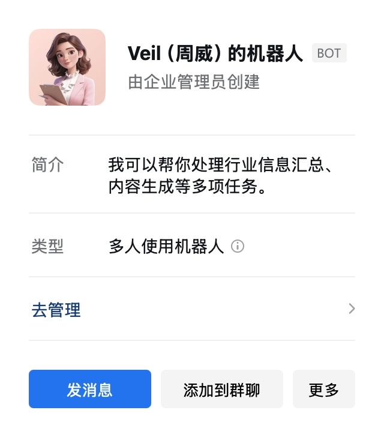
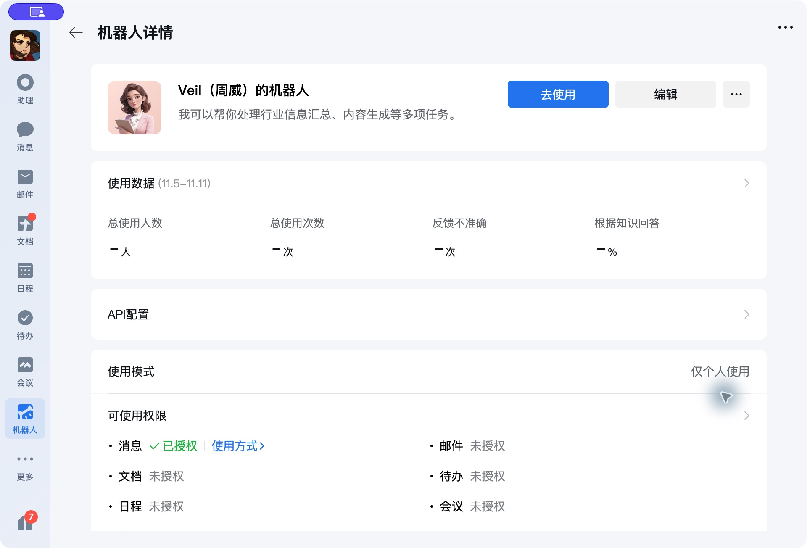
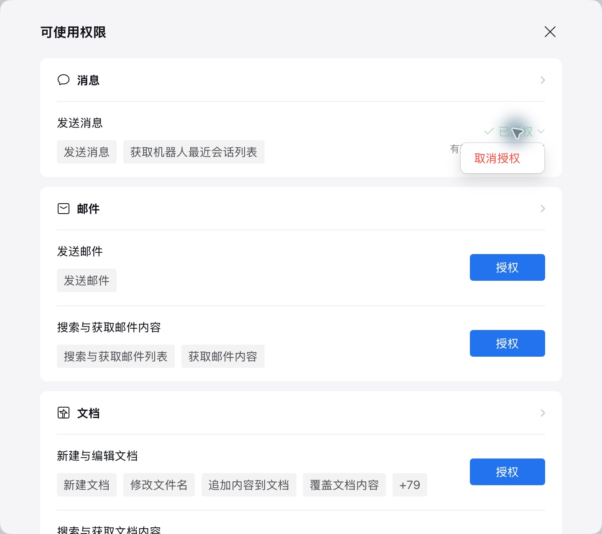
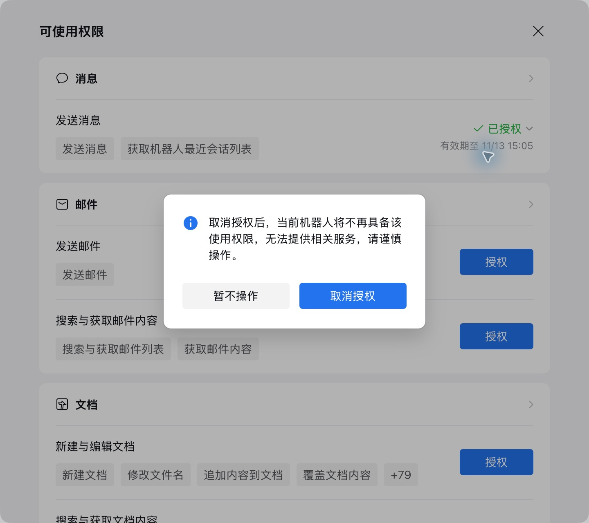
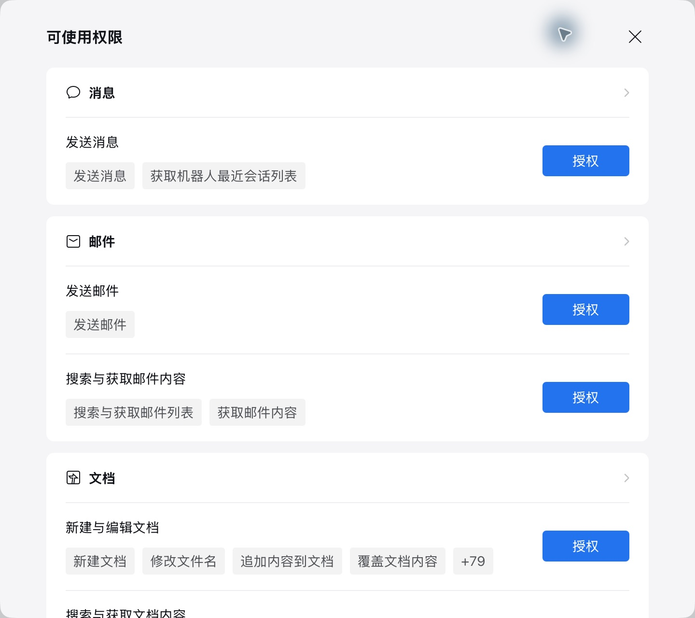
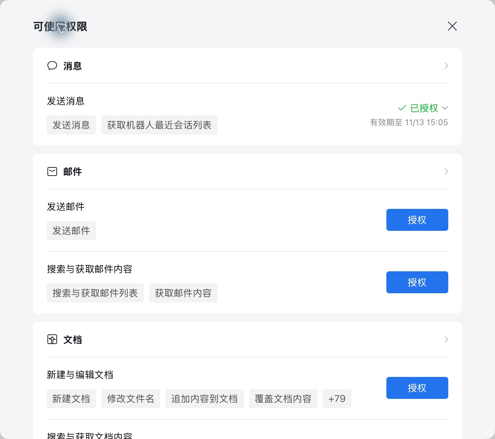
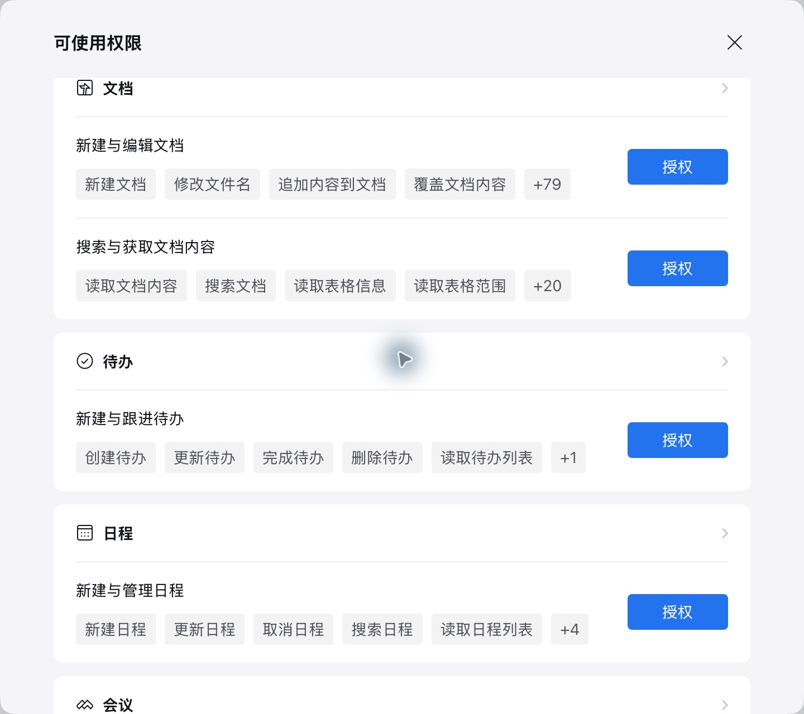

# 企业微信 Bot 纯人工手动续期

[下载图文 PDF](../delivery/releases/2026-11-11/纯人工手动续期-企业微信Bot图文指南.pdf)。全程在企业微信中操作，无需 Agent、脚本或 CLI 命令。截图来自 Mac 5.0.13/95049 中文版，其他版本和 Windows 的界面可能不同。

## 1. 找到自己要维护的 Bot

登录 Bot 创建者主账号，核对当前组织。已有私聊时，搜索 Bot 名称，进入私聊后点击顶部名称。没有私聊时，从“机器人”目录，或“更多 → 通讯录 → 智能机器人”找它，从资料卡的“发消息”进入私聊。

在资料卡中点击“去管理”；如果进入管理列表，再找到同一个 Bot，点击其“详情”。管理列表可能分企业创建和成员创建；不要因为一处列表里没找到它就新建 Bot。

## 2. 打开可使用权限

在“机器人详情”核对名称，进入“可使用权限”。无需修改 API 配置。

- 显示“已授权”与有效期：记录旧时间，要提前续期时先取消再授权。
- 显示“授权”：若这是业务原来使用的权限，直接重新授权。该按钮也可能表示从未授权，不能把所有未授权能力都当成过期权限。

## 3. 提前续期时，先取消再立即重授

点击对应行的“已授权”或下拉箭头，再点“取消授权”。

在确认框核对范围后点击蓝色“取消授权”；选错则点“暂不操作”。取消后会短暂失去这项能力，不要取消后就关页。

## 4. 重新授权并核对日期

在同一行点击蓝色“授权”；如有确认页，核对 Bot 和权限后确认。提示仅创建者可操作时，由创建者主账号处理。

等待“已授权”及“有效期至”；提前续期时，新时间必须晚于旧时间。关闭权限页，再从同一 Bot 重新打开复查。

图中的日期是原状态，非本次续期结果。取图时未取消或授予业务权限；“授权”按钮截图来自另一示例 Bot，不能把这两张图当作一次操作的前后对照。

## 5. 逐项完成并关页

每次只处理一项，恢复成功后再处理下一项。文档、微盘和邮件的读取与写入可能分别授权；“发送消息”有效不代表其他能力也有效。

| 用途 | 对应权限行 |
| --- | --- |
| 消息 | 发送消息 |
| 文档与表格 | 搜索与获取文档内容；需要写入时另处理新建与编辑文档 |
| 微盘 | 搜索与获取微盘文件内容；需要写入时另处理上传与更新微盘文件 |
| 邮箱 | 搜索与获取邮件内容；需要发信时另处理发送邮件 |

核对所需权限的新日期，用日常业务做一次轻量验证，最后点击权限页右上角“×”关闭。按实际到期时间设置提前一天的提醒；纯人工方案不会自动续期。

找不到 Bot 先核对组织和目录；日期没延长则重新打开页面复查；仍报过期时核对是否漏了另一项读写权限。取消后重授失败，先恢复当前项，不要继续取消其他权限，也不要重建 Bot、重置 Secret 或重新扫码来解决过期。
